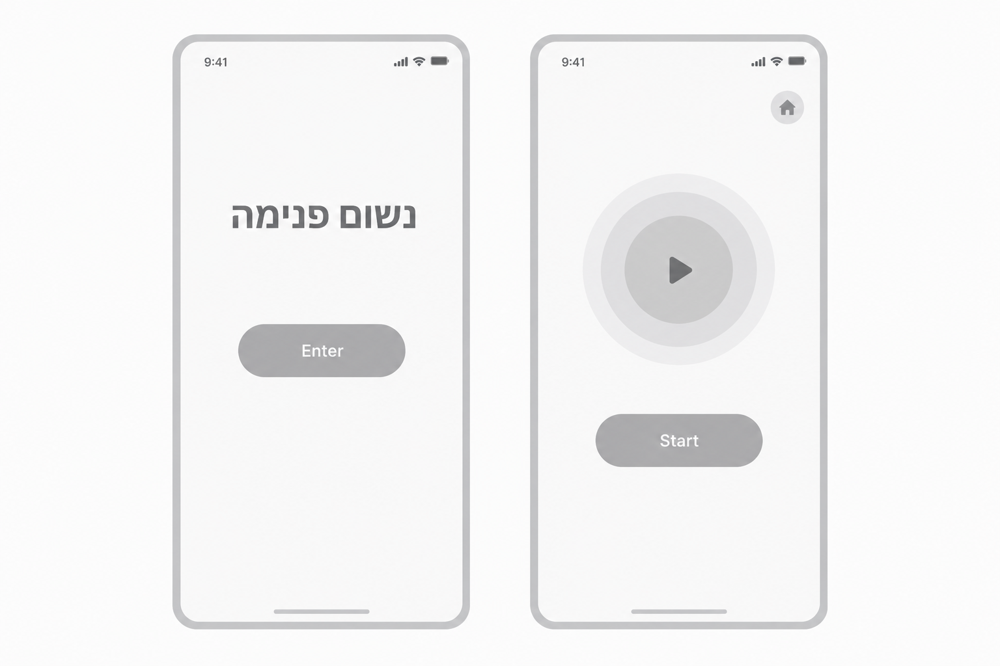
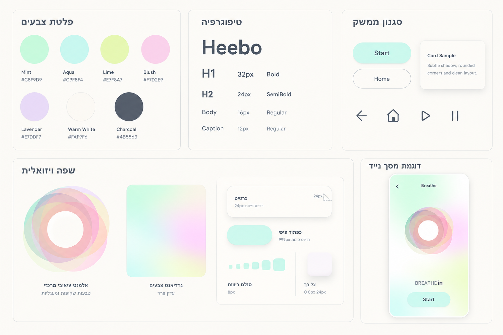
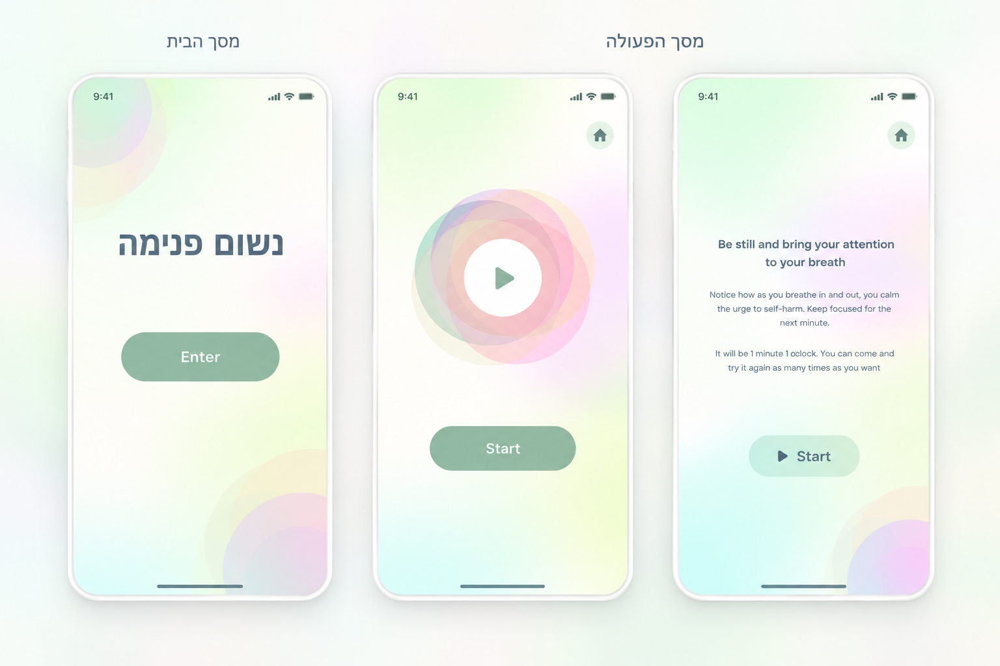

# DESIGN — נשום פנימה (Breathe In)

מסמך זה מגדיר את עיצוב ממשק האפליקציה על בסיס ה־PRD, ה־Wireframes, ה־Style Guide וה־Mockups. במקרה של סתירה, ה־PRD קובע את הפונקציונליות, ה־Wireframes קובעים את מספר המסכים ואת מבנם, וה־Style Guide וה־Mockups מנחים את המראה החזותי.

## 1. Screens – מסכי האפליקציה

האפליקציה כוללת **שני מסכים בלבד**. התמונה שנוצרה כ־Mockups כוללת בטעות מסך שלישי עם הוראות נשימה; מסך זה אינו חלק מהמוצר ואין לממש אותו. העיגול עם סמל Play במרכז מסך הפעולה הוא כפתור לחיץ, שפועל בדיוק כמו כפתור `Start` (ראו 1.2).

### 1.1 מסך הבית

**מטרה:** הצגת שם האפליקציה וכניסה למסך הפעולה.

**מבנה ותוכן:** תצוגת מובייל מינימליסטית, רקע בהיר עם גרדיאנטים פסטליים עדינים, כותרת מרכזית **„נשום פנימה”** וכפתור ראשי **`Enter`** מתחתיה. מרווחים גדולים בין הרכיבים, ללא תפריט, טופס, כרטיסי תוכן או טקסטי הסבר.

**פעולות וניווט:** לחיצה על `Enter` עוברת למסך הפעולה. אין השמעת אודיו במסך הבית.

### 1.2 מסך הפעולה

**מטרה:** הפעלת צלילים קצרים.

**מבנה ותוכן:** במרכז מוטיב טבעות חופפות ושקופות למחצה, ובמרכזן עיגול לבן עם סמל Play; מתחתיו כפתור ראשי **`Start`**. הרקע, המרווחים וסגנון הכפתור עקביים עם מסך הבית. אין טיימר, הנחיות נשימה, רשימת צלילים או רכיבי פעולה נוספים, מלבד כפתור "הפעלת קול" המוצג רק במצב חסימת שמע (ראו להלן).

**פעולות וניווט:** בכניסה למסך נעשה ניסיון להשמיע את צליל הפלוץ. לחיצה על `Start` — או על העיגול עם סמל ה־Play — בוחרת ומשמיעה צליל אקראי מתוך ארבעת הצלילים, ללא מניעת חזרות. שני הכפתורים מפעילים את אותה פעולה בדיוק. אין במסך כפתור `Home` או קישור למסך הבית — מסך הבית מוצג רק בפתיחה מחדש של האפליקציה. (אייקון הבית המופיע ב־Wireframes וב־Mockups הוסר מהמוצר.)

**מצב חסימת שמע ("הפעלת קול"):** אם הדפדפן חוסם השמעה, מוצג באותו מסך (ולא כמסך נוסף) כפתור עגול קטן עם אייקון **רמקול מושתק** — רמקול בתוך עיגול, עם קו אלכסוני עליו. אין טקסט גלוי לצד האייקון. לכפתור שם נגיש (`aria-label`) בעברית: „הפעלת קול”. לחיצה עליו מנסה להשמיע שוב את הצליל שנחסם, והכפתור נעלם לאחר השמעה מוצלחת. הכפתור עדין ואינו בולט יותר מ־`Start`: עיגול בהיר קטן עם אייקון כהה מן הפלטה, וממוקם מעל כפתור `Start`, מתחת לטבעות.

### 1.3 ניווט כללי

`מסך הבית` → `Enter` → `מסך הפעולה`. הניווט חד־כיווני; מסך הבית מוצג שוב רק בפתיחה מחדש של האפליקציה.

### Wireframes

## 2. Style Guide – השפה העיצובית

השפה החזותית רגועה, נקייה ואוורירית. מאפייניה: גווני pastel בהירים, גרדיאנטים רכים, פינות מעוגלות, טבעות שקופות חופפות, טיפוגרפיה ברורה וצללים עדינים. יש להימנע מאיורים של דמויות, מצילומים ומקישוטים שאינם תואמים את ה־Wireframes.

### Style Guide חזותי

### 2.1 Color Palette

הערכים הבאים נלקחו מלוח ה־Style Guide שנוצר:

| צבע | HEX | שימוש |
|---|---|---|
| Mint | `#C8F9D9` | רקעים ומעברי צבע |
| Aqua | `#C9F8F4` | רקעים וכפתורים עדינים |
| Lime | `#E7F8A7` | הדגשת גרדיאנט רכה |
| Blush | `#F7D2E9` | טבעות וגרדיאנט |
| Lavender | `#E7DDF7` | טבעות וגרדיאנט |
| Warm White | `#FAF9F6` | משטח בסיס בהיר |
| Charcoal | `#4B5563` | טקסט ואייקונים |

צבעים נוספים, שנדגמו מתמונת ה־Mockups:

| צבע | HEX | שימוש |
|---|---|---|
| Sage | `#92B8A2` | רקע הכפתורים הראשיים `Enter` ו־`Start` |
| White | `#FFFFFF` | טקסט הכפתורים הראשיים ומרכז הטבעות |

יש להשתמש בצבעים בעוצמות רכות ובשקיפויות, ללא צבעים רוויים חדשים. **צבע הכפתורים הראשיים נקבע לפי ה־Mockups** (ירוק מרווה עם טקסט לבן), ולא לפי הכפתור הבהיר בלוח ה־Style Guide.

### 2.2 Typography

**פונט אחיד:** `Heebo`, עם הבדלים בגודל ובמשקל בלבד.

| תפקיד | גודל | משקל |
|---|---:|---|
| H1 | 32px | Bold |
| H2 | 24px | SemiBold |
| Body | 16px | Regular |
| Caption | 12px | Regular |

הכותרת במסך הבית ממורכזת ומודגשת. כיתובי הכפתורים ממורכזים וקריאים. יש לשמור על היררכיה אחידה בשני המסכים ולהימנע מערבוב משפחות פונטים.

### 2.3 UI Style

**כפתורים:** `Enter` ו־`Start` הם כפתורי pill רחבים יחסית, בעלי פינות מעוגלות מאוד, רקע Sage (`#92B8A2`) וטקסט לבן ממורכז, כמו ב־Mockups. יש לשמור על אותו סגנון בשני המסכים. כפתור "הפעלת קול" (רמקול מושתק) הוא כפתור משני קטן ועגול, בהיר, עם אייקון כהה מן הפלטה. העיגול עם סמל ה־Play במרכז הטבעות הוא כפתור לחיץ ומציג מצב Focus גלוי.

**שדות, כרטיסים ותפריטים:** אין במוצר שדות קלט, כרטיסי מידע או תפריטים. דוגמאות לרכיבים כאלה בלוח ה־Style Guide הן דוגמאות שפה חזותית בלבד, ואין להוסיף אותן למסכים.

**אייקונים:** קו נקי, עובי עקבי, גוון כהה מן הפלטה. האייקונים במוצר: Play (במרכז הטבעות) ורמקול מושתק ("הפעלת קול"). אין להוסיף אייקונים נוספים.

### 2.4 Visual Style

**צורות:** מוטיב מרכזי של טבעות עגולות, חופפות ושקופות למחצה, בצבעי Mint, Blush, Lavender וגוונים משלימים. מרכז הטבעות בהיר.

**רקעים:** גרדיאנטים פסטליים עדינים על בסיס בהיר. יש לשמור על קריאות הכותרת והכפתורים מעל הרקע.

**פינות וקווי מתאר:** פינות מעוגלות, קווי מתאר בהירים ודקים במקומות שבהם יש צורך בהפרדה. ללא מסגרות כבדות.

**צללים:** רכים ומטושטשים, באטימות נמוכה. אין צללים חדים או כהים.

**Spacing ו־Layout:** פריסה Mobile-first, רכיבים מרכזיים ממורכזים, שטח ריק נדיב. במסך הבית הכותרת נמצאת מעל כפתור `Enter`. במסך הפעולה הטבעות במרכז וכפתור `Start` מתחתיהן. יש לשמור על פרופורציות מסך סמארטפון ועל עקביות בריווחים בין המסכים. ערכי Spacing מדויקים שאינם מוצגים במקורות ייקבעו בעת המימוש לפי היחסים החזותיים, ולא יוצגו כערכי מקור מחייבים.

**תמונות ואיורים:** אין שימוש בצילומים. הטבעות הן אלמנט גרפי מופשט, ולא איור דמות או תוכן נוסף; העיגול הלבן עם סמל ה־Play שבמרכזן הוא כפתור.

### 2.5 שפה וכיווניות

שפת הממשק היא **עברית**, בכיווניות **RTL** (`lang="he"`, `dir="rtl"`). שם המוצר מוצג כ־**„נשום פנימה”**. תוויות הפעולה `Enter` ו־`Start` נשמרות כפי שהן מופיעות ב־Wireframes. יש לשמור על יישור RTL לטקסט עברי ועל מרכוז הרכיבים המרכזיים.

### Mockups

## 3. כללי עקביות למימוש

- **מספר המסכים המחייב: שניים.** אין לממש את המסך השלישי המופיע בטעות בתמונת ה־Mockups.
- מבנה, תוכן ורכיבים: לפי ה־PRD וה־Wireframes; מראה: לפי ה־Style Guide וה־Mockups, בכפוף למבנה המחייב.
- אין להוסיף טיימר, הוראות נשימה, תפריט, שדות, דמויות או פעולות שאינן מוגדרות במקורות.
- העיגול עם סמל ה־Play וכפתור `Start` מפעילים את אותה פעולה בדיוק.
- כפתור "הפעלת קול" (רמקול מושתק) מוצג רק במצב חסימת שמע.
- אין להוסיף קישורים לגורמי תמיכה או סיוע (כגון קווי חירום) — החלטת בעלת המוצר.
- יש להגדיר את צבעי הפלטה ואת ערכי הטיפוגרפיה כ־Design Tokens, ולשמור על שימוש עקבי.
- יש לוודא קריאות, ניגודיות, מצבי Focus וגדלי לחיצה מתאימים במסכי מובייל.
- שלוש התמונות מוטמעות בנתיבים יחסיים; כדי שהן יוצגו יש לשמור אותן באותה תיקייה עם `DESIGN.md`.
